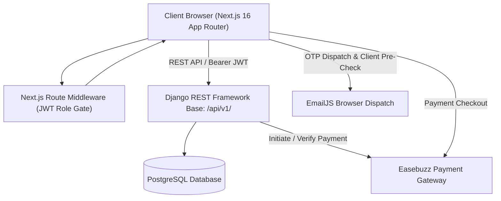
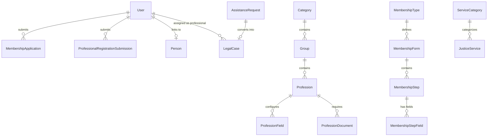

# ICJ Enterprise Platform — Comprehensive Existing System Audit Report (Part 1 of 3)

**Platform:** International Consortium of Jurists (ICJ Trust)  
**Audit Scope:** Fullstack Codebase (Django REST Framework Backend + Next.js App Router Frontend)  
**Execution Mode:** Read-Only Static and Architectural Analysis  
**Date of Audit:** October 2026  

---

## Executive Summary

The **ICJ Enterprise Platform** is a dual-tier fullstack web application consisting of a **Django REST Framework (DRF)** backend and a modern **Next.js 16 (React 19, MUI v9)** frontend. The architecture is engineered around dynamic onboarding workflows, administrative governance, membership management, justice services empanelment, and legal case coordination.

The core identity, authentication, dynamic onboarding configurations, membership workflows, payment gateway integration (Easebuzz), and professional directories are robustly implemented and operational. However, there is a clear boundary where newer commercial features (such as the **Lead Marketplace & Professional Wallets**) and secondary support functions (such as **Ombudsman Grievances**, **Donation Tracking**, and **Knowledge Management**) currently exist only as frontend interfaces or mock services, lacking corresponding backend database models and API routes.

---

## 1. Architectural Topology & Tech Stack

### Technology Matrix
| Layer | Technology | Version / Configuration | Details |
| :--- | :--- | :--- | :--- |
| **Frontend Framework** | Next.js (App Router) | `16.3.4` (Turbopack) | React `19.2.8`, TypeScript `5.x` |
| **Frontend UI / Styling** | Material UI (MUI) | `@mui/material 9.4.0` | Custom themes, Emotion CSS-in-JS |
| **Backend Framework** | Django / DRF | `Django 5.x` / DRF `3.15+` | Python `3.10+` |
| **Authentication** | SimpleJWT | `rest_framework_simplejwt` | Access: 30m, Refresh: 7d, Blacklisting |
| **Database** | PostgreSQL | PostgreSQL 15+ (Render/Local) | `django.db.backends.postgresql` |
| **Payment Gateway** | Easebuzz Gateway | Key: `P2OTPKQ5X` | Test Mode, SHA-512 Hash Verification |
| **Email & Verification**| EmailJS + Console/SMTP | EmailJS Client API + Django Mail | Browser OTP + Transactional Fallback |

---

## 2. Module Implementation Classification

### A. Fully Implemented Modules (Production Ready)

These modules are completely wired across Frontend UI, API Client Services, DRF Views/Serializers, and PostgreSQL Database Models.

| Module | Frontend Evidence | Backend Evidence | Description / Capabilities |
| :--- | :--- | :--- | :--- |
| **Authentication & IAM** | `app/(auth)/login` `services/auth.service.ts` `middleware.ts` | `apps/accounts/models/user.py` `apps/accounts/views/auth.py` | JWT authentication, role resolution (`super_admin`, `admin`, `professional`, `member`), password recovery, role middleware, automatic account provisioning upon application approval. |
| **Email Verification & Token Saver** | `components/ui/EmailVerificationField.tsx` `emailVerification.service.ts` | `apps/accounts/views/auth.py` (`CheckEmailAvailabilityView`) `apps/accounts/services/identity_checks.py` | Universal pre-check of email uniqueness before sending OTP to save EmailJS quota; format validation, blur detection, and multi-tab broadcast sync. |
| **Professional Onboarding Engine** | `components/features/onboarding/` `services/admin/professionalOnboarding.service.ts` | `apps/professional_onboarding/models/` `apps/professional_onboarding/views/` | 3-tier taxonomy (Category → Group → Profession), dynamic common & profession fields, required documents, cascading visual themes, multipart file uploads, idempotency keys, and application review (Approve/Reject/Under Review). |
| **Membership Onboarding & Payment** | `app/(public)/join-membership/` `services/public/membershipOnboardingPublic.service.ts` | `apps/membership_onboarding/models/` `apps/membership_onboarding/services/easebuzz_client.py` | Multi-step dynamic form schema, identity deduplication, Easebuzz checkout order creation, hash verification, payment skip toggle, and administrative subscription fee configuration. |
| **Admin User Management** | `app/(admin)/admin/users/` `services/admin/adminUsers.service.ts` | `apps/accounts/views/admin_users.py` `apps/accounts/urls/admin_users.py` | Administrative CRUD, search by name/email/profession, account activation/deactivation, status toggles, and administrative password resets. |
| **Honorable Advisory Board** | `app/(public)/honorary-advisory-board/` `app/(admin)/admin/honorable-advisory-*` | `apps/honorable_advisory/models.py` `apps/honorable_advisory/views.py` | Advisory member directory, dynamic nomination form fields, public applications, display ordering, and admin approval workflows. |
| **Justice Services & Seek Assistance** | `app/(public)/services/` `app/(public)/assistance/` `app/(admin)/admin/assistance-onboarding/` | `apps/services/models.py` `apps/services/views/admin.py` `apps/services/views/public.py` | Justice services directory, public seek-assistance intake, dynamic legal matter form fields, required document configurations, and case conversion. |
| **Professional Case Management** | `app/(dashboard)/dashboard/professional/cases/` `services/professional/professionalCases.service.ts` | `apps/services/models.py` (`LegalCase`) `apps/services/views/professional.py` | Empaneled professionals can view available cases, take ownership of open legal cases, and manage assigned cases. |

---

### B. Partially Implemented Modules (Frontend Functional, Backend Stubs or Mock Data)

These modules feature complete UI pages, forms, and client services, but rely partially or wholly on client-side simulation, mock datasets, or missing persistent backend models.

| Module | Frontend Evidence | Current Reality / Missing Backend |
| :--- | :--- | :--- |
| **Admin Dashboard KPI & Metrics** | `app/(admin)/admin/dashboard/page.tsx` `services/admin/adminDashboard.service.ts` | Fetches real counts for advocates, users, and cases via `Promise.allSettled`, but financial revenue, marketplace metrics, and historical trend curves are simulated client-side. |
| **Grievance / Ombudsman Intake** | `app/(public)/grievance/page.tsx` `services/public/otherServices.ts` | Frontend has a comprehensive complaint intake form with category selection. However, `grievanceService.submitGrievance` generates a simulated ticket ID via `setTimeout(400ms)` and does not persist to a PostgreSQL model. |
| **Donations & Mudra Contribution** | `app/(public)/donate/page.tsx` `app/(public)/verify-donation/page.tsx` `services/public/otherServices.ts` | Full donation UI, tier selection, and receipt verification screens exist, but verify against `mockDonationReceipts` without a backend `Donation` model or payment gateway connection. |
| **Knowledge Centre & Research Papers** | `app/(public)/knowledge-centre/page.tsx` `app/(public)/research/page.tsx` `services/public/otherServices.ts` | Fully filterable and paginated UI for articles and legal papers, but reads strictly from in-memory arrays in `data/public/knowledge.ts` and `data/public/research.ts`. No admin CMS exists to create or edit articles. |
| **Certificate Verification** | `app/(public)/verify-certificate/page.tsx` `services/public/otherServices.ts` | Client verification form verifies against `mockCertificates` rather than querying real `MembershipRecord` or `ProfessionalRegistrationSubmission` records. |
| **Subscription Plan Hierarchy** | `app/(admin)/admin/subscriptions/page.tsx` | Controls the single Membership fee in `MembershipFeeSettings`, but does not support tiered subscription recurring billing, billing intervals (monthly/annual), or institutional subscription packages. |

---

### C. Missing Modules (404s, Placeholders, or Unimplemented Backends)

These modules are present in sidebar navigation or route schemes, but lack underlying backend endpoints or frontend component logic.

| Module / Route | Status | Detail & Impact |
| :--- | :--- | :--- |
| **Lead Marketplace & Professional Wallets** `/admin/leads/*` `/admin/wallets/*` `/admin/lead-plans/*` `/dashboard/professional/leads/*` `/dashboard/professional/wallet/*` | **Missing Backend Models & APIs** | The frontend services (`adminLeads.service.ts`, `leadMarketplace.service.ts`) contain calls to `/api/v1/admin/leads/`, `/api/v1/admin/wallets/`, etc., but **no Django models, views, or URLs exist** in the backend. Navigating here results in API 404 errors. |
| **Admin Appointments** `/admin/appointments` | **Placeholder Stub** | Displays: *"This section is ready for implementation. Connect the Django REST API..."* |
| **Admin Documents Management** `/admin/documents` | **Placeholder Stub** | Displays: *"This section is ready for implementation..."* |
| **Admin Content Management** `/admin/content` | **Placeholder Stub** | Displays: *"This section is ready for implementation..."* |
| **Admin Events Management** `/admin/events` | **Placeholder Stub** | Displays: *"This section is ready for implementation..."* |
| **Admin Grievances Management** `/admin/grievances` | **Placeholder Stub** | Displays: *"This section is ready for implementation..."* |
| **Admin Notifications Engine** `/admin/notifications` | **Placeholder Stub** | Displays: *"This section is ready for implementation..."* |
| **Admin Platform Reports** `/admin/reports` | **Placeholder Stub** | Displays: *"This section is ready for implementation..."* |
| **Admin Legal Research** `/admin/research` | **Placeholder Stub** | Displays: *"This section is ready for implementation..."* |
| **Public Track Case** `/track-case` | **Placeholder Stub** | Displays: *"Public case tracking portal coming soon."* |

---

## 3. Database Schema & Dependency Analysis

### Key Database Relationships
1. **`accounts.User`**: Central authentication model. Derives multi-role platform permissions (`get_all_roles()`) dynamically from approved membership applications and professional registration records.
2. **`person.Person`**: Master profile entity linking individual biometric/identity data (email, phone, national ID) across memberships and empanelled roles.
3. **`professional_onboarding`**: Hierarchical configuration models (`Category` → `Group` → `Profession`) with isolated `VisualTheme` cascade and dynamic custom fields.
4. **`membership_onboarding`**: Step-driven form schema models with `MembershipFeeSettings` managing Easebuzz payments and `MembershipRecord` issuing verified memberships.
5. **`services.AssistanceRequest` & `services.LegalCase`**: Citizen intake requests convert directly into `LegalCase` records assigned to verified `accounts.User` professionals.

---

## 4. Existing Bugs & Technical Debt

### High Priority
1. **Missing Backend for Lead Marketplace & Wallets**:
   - *Evidence*: `frontend/src/lib/api/endpoints.ts` lines 110-142 define 20+ routes under `/admin/leads/` and `/professional/leads/`.
   - *Issue*: `backend/config/urls.py` contains zero mappings for these routes, causing HTTP 404 network failures when professionals attempt to access wallets or buy leads.
2. **Ephemeral Local Storage for Uploaded Media (`MEDIA_ROOT`)**:
   - *Evidence*: `settings.py` sets `MEDIA_ROOT = BASE_DIR / "media"`.
   - *Risk*: In any containerized or serverless hosting environment (e.g., Render, Railway, AWS ECS), uploads to the local filesystem are destroyed upon server restarts or redeployments. Government IDs and certificates require persistent cloud object storage (e.g., AWS S3, Cloudflare R2, or Google Cloud Storage).

### Medium Priority
3. **Dead / Orphan App Directory (`apps/honorary_advisory`)**:
   - *Evidence*: `backend/apps/honorary_advisory/` exists alongside `backend/apps/honorable_advisory/`.
   - *Issue*: `settings.py` only registers `apps.honorable_advisory`. The duplicate folder contains unapplied migrations and stale code, creating confusion and namespace risks.
4. **Unindexed JSON Field Lookups**:
   - *Evidence*: `apps/accounts/services/identity_checks.py` executes `Q(field_values__email__iexact=...)` and phone scans across JSON fields.
   - *Issue*: Without GIN indexing or indexed extraction, these queries perform full sequential table scans that will degrade performance as application records exceed 10,000+.
5. **Client-Side Mock Fallback Inconsistency**:
   - *Evidence*: `adminKyc.service.ts` is backed by `_kycStore = [...mockKycApplications]` (empty array), while `adminAdvocates.service.ts` queries the live DRF database.

### Low Priority
6. **Next.js Turbopack Warning**:
   - `npm warn Unknown env config "cache-dir"` emitted during installation due to older `.npmrc` settings.

---

## 5. Security, Performance & Scalability Review

### Security Findings
| Area | Assessment | Recommendation |
| :--- | :--- | :--- |
| **Authentication Tokens** | JWT stored in HTTP cookie `icj_access_token` and sent via `Bearer` headers. Rotation and blacklisting enabled. | Enforce `HttpOnly`, `SameSite=Lax`, and `Secure` attributes across all production environments. |
| **Middleware Authorization**| Next.js `middleware.ts` decodes JWT payload using base64 without cryptographic signature verification. | The edge middleware relies on DRF backend APIs to perform definitive signature verification; this is acceptable, but tampering could expose public client UI shells before API denial. |
| **Rate Limiting** | Rate throttles configured for `login` (10/min) and `forgot_password` (5/hour). | Add global IP throttling to public registration endpoints (`/membership-onboarding/register/`, `/professional-onboarding/register/`) to prevent automated spam. |
| **Credential Hardcoding** | `.env.example` contains fallback keys (`P2OTPKQ5X`, `APYJMJTBT`, `_afNcmKvmFJoVdlI9`). | Ensure production environment variables strictly override all defaults. |

---

## 6. Test Coverage & Build Status

- **Backend Pytest Suite**:
  - `apps/accounts/tests/test_auth.py`: 14 tests (credentials, token single-use, password complexity, reset links).
  - `apps/professional_onboarding/tests/test_admin_config_api.py`: 8 tests (CRUD, hierarchy, field assignments).
  - `apps/professional_onboarding/tests/test_professional_registration.py`: 2 tests (single submission, idempotency protection).
  - `apps/professional_onboarding/tests/test_visual_theme_api.py`: 3 tests (inheritance, resolution).
  - `apps/membership_onboarding/tests/test_membership_onboarding_api.py`: 5 tests (types, config, public submissions).
  - *Coverage Status*: Core onboarding, authentication, and configuration APIs are well tested. `apps/services` and `apps/honorable_advisory` lack dedicated automated test files.
- **Frontend Build Status**:
  - Next.js development server running cleanly on Turbopack (`npm run dev`).
  - Production bundle compilation verified on git branch `pushpendra-frontend`.
  - No frontend unit or E2E test framework (Jest / Playwright) is currently configured.

---

## 7. Recommended Priority Roadmap

### Phase 1: Stabilization & High-Yield Completeness (Immediate)
1. **Remove / Clean Up Orphan Directory**: Safely delete the dormant `backend/apps/honorary_advisory/` directory to prevent migration confusion.
2. **Cloud Storage Integration**: Connect `django-storages` with AWS S3 / Cloudflare R2 for user documents, KYC files, and profile pictures.
3. **Database Performance Indexing**: Add functional or B-Tree/GIN indexes for emails and mobile numbers in dynamic JSON fields.

### Phase 2: Missing Core Backend Implementations (Next Phase)
1. **Lead Marketplace & Wallet Backend Engine**:
   - Create `apps/marketplace` with models: `Lead`, `LeadPurchase`, `ProfessionalWallet`, `WalletTransaction`, `LeadCreditPlan`.
   - Implement DRF views matching `API_ENDPOINTS.adminLeads` and `API_ENDPOINTS.professionalLeads`.
2. **Ombudsman Grievances & Case Tracking Backend**:
   - Create `GrievanceTicket` model in `apps/services` to replace frontend `setTimeout` simulation.
   - Implement public case tracking lookup endpoint (`/api/v1/services/track-case/<case_id>/`).

### Phase 3: Secondary Stubs & Administrative Tooling
1. Implement the 8 placeholder admin modules (`appointments`, `documents`, `content`, `events`, `grievances`, `notifications`, `reports`, `research`) or hide them from the sidebar until scheduled for release.
2. Introduce automated frontend smoke tests using Playwright.
